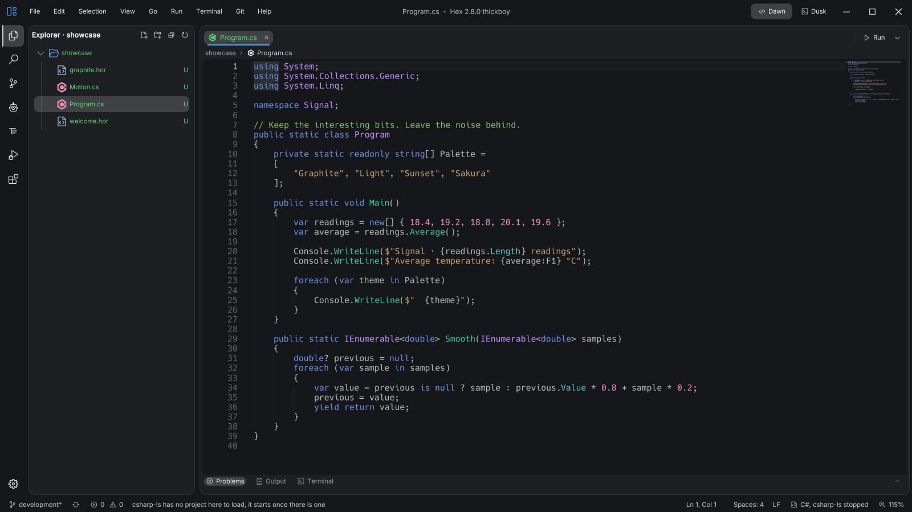
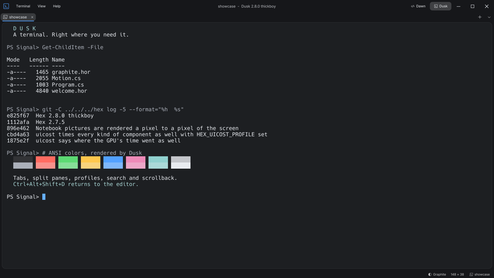
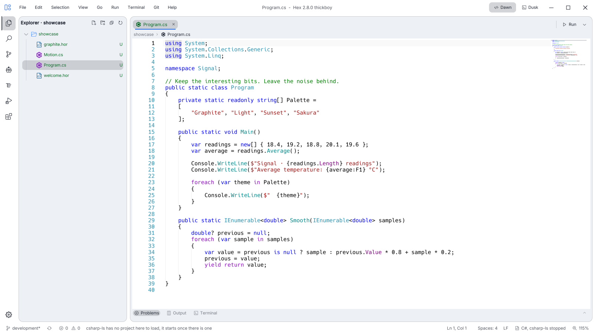
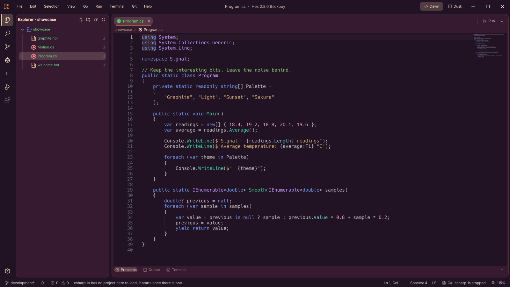

# Modern Motherfucking Code Editor

**This is Hex. It opens, you write code, and it gets the fuck out of your way.**

That's the entire fucking point. A native code editor, a proper terminal, and the tools around them.
No Electron. No Chromium in a trench coat. No account to open a text file.

**[Download](#get-it) · [The numbers](#fast-as-fuck-with-receipts) · [Features](#lightweight-doesnt-mean-does-fuck-all) · [Appearance](#make-it-look-how-you-want) · [Build](#build-the-bloody-thing)**



*Dawn, the editor. Graphite, C#, and room to think. Captured from the local 2.8.0 development build; code at 115%.*

## Get it

Pick your machine. **Setup** handles installation, shortcuts and updates. **Portable** is a ZIP you unpack and run.
Neither needs a separate .NET installation.

| System | Setup | Portable |
| --- | --- | --- |
| Windows | [x64](https://github.com/bogzxo/hex/releases/latest/download/Hex-Setup-win-x64.exe) · [ARM64](https://github.com/bogzxo/hex/releases/latest/download/Hex-Setup-win-arm64.exe) | [x64](https://github.com/bogzxo/hex/releases/latest/download/Hex-win-x64.zip) · [ARM64](https://github.com/bogzxo/hex/releases/latest/download/Hex-win-arm64.zip) |
| Linux | [x64](https://github.com/bogzxo/hex/releases/latest/download/Hex-Setup-linux-x64.zip) · [ARM64](https://github.com/bogzxo/hex/releases/latest/download/Hex-Setup-linux-arm64.zip) | [x64](https://github.com/bogzxo/hex/releases/latest/download/Hex-linux-x64.zip) · [ARM64](https://github.com/bogzxo/hex/releases/latest/download/Hex-linux-arm64.zip) |
| macOS | [Apple silicon](https://github.com/bogzxo/hex/releases/latest/download/Hex-Setup-osx-arm64.zip) · [Intel](https://github.com/bogzxo/hex/releases/latest/download/Hex-Setup-osx-x64.zip) | [Apple silicon](https://github.com/bogzxo/hex/releases/latest/download/Hex-osx-arm64.zip) · [Intel](https://github.com/bogzxo/hex/releases/latest/download/Hex-osx-x64.zip) |

Windows Setup is an EXE; unpack the Linux and macOS Setup ZIPs first.
[All releases](https://github.com/bogzxo/hex/releases) · [What changed](RELEASE_NOTES.md) · [Installation details](docs/installer.md)

Windows needs **10 1809 or newer**. Linux needs a Vulkan loader and driver; on Debian/Ubuntu that's
`libvulkan1` and the appropriate GPU driver, such as `mesa-vulkan-drivers`. macOS needs **11 or newer**.
The macOS build is unsigned; after downloading from this repository, remove quarantine from the unpacked folder with
`xattr -dr com.apple.quarantine /path/to/Hex` if macOS blocks it.

## Fast as fuck, with receipts

**492 ms to Dawn's first frame. 474 ms to Dusk's. A 45.0 MiB ZIP for both.**

Fresh measurements from the **local 2.8.0 development build**, published with the checked-in
[`FolderProfile`](Hex/Properties/PublishProfiles/FolderProfile.pubxml): Release, Windows x64, NativeAOT, self-contained.
Measured on 4 November 2026, Windows 11, Ryzen 5 5600X, RTX 3060, 32 GB RAM.

| Measurement | Dawn — editor | Dusk — terminal |
| --- | ---: | ---: |
| Process start → first rendered scene, median | **492 ms** | **474 ms** |
| First-frame range, 10 launches each | 472–527 ms | 455–484 ms |
| Idle working set, median | **149.8 MiB** | **114.1 MiB** |
| Idle CPU, median, as a percentage of one logical core | 4.33% | 12.81% |


**The first launch of each mode is excluded.** It populates shader caches. These are subsequent launches,
with Dawn opening this repository and a C# source file, and Dusk opening one shell. First frame means first frame;
it doesn't mean every language server has finished indexing. Memory and CPU cover Hex itself, not child shells or
language servers. This is one machine, not a race rigged against somebody else's editor.

The local published folder is **101.3 MiB**, zipped to **45.0 MiB** before runtime caches. It includes both modes and
their assets. Release downloads may differ. [Method, raw samples and reproduction commands](docs/benchmarks.md).

### A game engine underneath. Seriously.

Hex is C# compiled ahead of time to native code. No JIT warming up while you stare at a splash screen.
The [Horizon engine](https://github.com/bogzxo/horizon) draws the interface through **Vulkan**, with rendering on its
own thread. On macOS, MoltenVK bridges that to Metal.

Text, panels, scrolling, animation and optional glass effects go through the rendering engine. There's no DOM to
lay out, no browser to haul around, and no reason a text editor should need either.

## Lightweight doesn't mean “does fuck all”

- **Code.** Language-server completion, hovers, definitions, references, rename, inlay hints and semantic highlighting.
  Folding, sticky scroll, minimap, format on save and `.editorconfig`. Install supported language servers from inside Hex;
  their own runtimes and dependencies still apply.
- **Git.** Gutter changes, stage and revert, blame, commits, branches, stash, history, diffs and merge-conflict controls.
  Keep the context next to the code instead of juggling windows to find out what you changed.
- **Find your shit.** Quick Open, command palette, workspace search and replace, searchable settings and configurable
  keybindings with conflict reporting. Import VS Code settings instead of rebuilding your preferences by hand.
- **Run and debug.** Workspace tasks and .NET debugging through **netcoredbg**: breakpoints, stepping and the Debug view.
  Project properties read and write the relevant `.csproj` settings. Debugging other stacks isn't promised here.
- **Documents that do things.** Jupyter notebooks with real kernels and outputs; native Markdown previews with tables
  and maths. Kernels are separate tools, not secretly bundled into the download number.
- **Build interfaces.** A live layout designer for Horizon and HIDL, component properties, and evaluated HIDL values
  beside the source. [Layouts and HIDL](docs/layouts-and-hidl.md).

## Dusk. A whole fucking terminal.



*Dusk, the terminal mode. PowerShell running a small showcase script: actual files, actual Git history, ANSI colors.*

Tabs, split panes, shell profiles, search, scrollback and a drop-down mode. ConPTY on Windows, a PTY on Linux and
macOS. Run it on its own with `Hex --dusk`, use the terminal panel inside Dawn, or switch modes from the title bar.
The editor stays where you left it.

In the development build shown here, **Ctrl+Alt+Shift+D** switches Dawn and Dusk. The shortcut is configurable.
You can also make Dusk your default terminal where the platform supports it; [the setup details are here](docs/hacking.md#building).

## Make it look how you want

| Light | Sunset |
| --- | --- |
|  |  |

*Same code, different mood. Click either image for the full-size capture.*

Hex3 comes in Solstice: flush panes and an accent for each mode. Go light with Solstice Day, back to quiet Graphite, or pick something warmer. **Settings → Appearance** has themes, skins, saved
looks, glass, backdrops and motion controls. Change the code size, terminal font, panel widths and keybindings too.
Keep it calm, make it loud, or switch the effects off. It's your screen, for fuck's sake.

## Bring your own agent. Or don't.

Hex doesn't sell you an AI subscription. The optional **Agents** view runs your installed Claude Code or Codex CLI,
with your own account. Choose the model, thinking level where supported, and permission or sandbox mode; follow the
conversation, tool calls and file links in the editor. Your provider's usage charges still belong to your provider.

Agents can also connect over MCP. Hex exposes repository maps, symbol search, references, focused code reads,
screenshots, editor commands and terminal tools, so an agent can ask for one method instead of swallowing the whole
bloody file. The server is off until enabled; sending from the Agents view enables it. [Agents and MCP](docs/agents.md).

## What it doesn't do

**It doesn't track you.** No built-in telemetry, analytics account or crash-report upload. No sign-in to edit code.

It does make network requests for features that need them: update checks, changelogs, extension and language-server
downloads, and the services you choose to use. Automatic extension and language-server update checks have switches.
Git remotes, language servers, extensions, notebook kernels and agent CLIs have their own network behavior.
“No telemetry” isn't a claim that `git fetch` works by fucking magic.

**It doesn't require an installer.** The portable archive works too. Hex uses a writable `settings` folder beside
the executable when available, with the platform's application-data folder as a fallback. [Platform details](docs/hacking.md#building).

## Build the bloody thing

Use the SDK in [`global.json`](global.json), currently .NET 11 preview. A standalone checkout needs Horizon's
`development` branch as well as Hex's extensions; this matches the engine checkout in CI.

```sh
git clone --branch development --recursive https://github.com/bogzxo/hex.git
cd hex
git clone --branch development --recursive https://github.com/bogzxo/horizon.git horizon
dotnet build Hex/Hex.csproj
```

For the **Windows x64 native build used above**:

```sh
dotnet publish Hex/Hex.csproj -p:PublishProfile=FolderProfile
```

NativeAOT publishing also needs the native toolchain: Visual Studio C++ build tools and the Windows SDK on Windows,
Clang and zlib development files on Linux, or Xcode command-line tools on macOS.
[Hacking on Hex](docs/hacking.md) covers the source and self-tests. [Benchmarking](docs/benchmarks.md) covers the measurements.

Found a bug? [Open an issue](https://github.com/bogzxo/hex/issues) with your OS, Hex version and steps to reproduce it.
Want to fix it? Send a focused pull request and say how you tested it. Screenshots help when the thing you changed is
the thing people look at.
