# Modern Motherfucking Code Editor

**This is an IDE. It opens FAST, you write FAST code, and it gets the fuck out of your way, FAST.**

That's the point. A native code editor, a proper terminal, a place for your agents, and the tools
around them. No Electron. No Chromium in a trench coat. No account to open a text file.

**[Website](https://bogzxo.github.io/hex/) · [Download](#get-it) · [The numbers](#fast-with-receipts) · [Under the hood](#under-the-hood) · [Gallery](#look-at-it) · [Build](#build-it)**

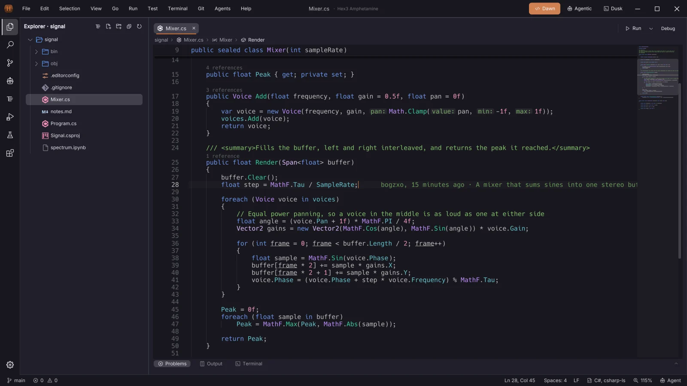

*Dawn, the editor, in Solstice. The colours, the reference counts and the blame are csharp-ls and git talking, not a
mockup. Taken from 3.3.0 at 3200 × 1800 on a 4K screen with the interface at 125%.*

Hex is one program with three faces, each in its own colour: **Dawn**, the code editor, in orange, **Dusk**, the
terminal, in violet, and **Agentic**, where your agents work, in teal. The title bar switches between them, and
whatever you were doing in one stays where you left it.

## Get it

Pick your machine. **Setup** adds shortcuts and keeps Hex up to date. **Portable** is a ZIP you unpack and run.
Neither needs a separate .NET installation.

| System | Setup | Portable |
| --- | --- | --- |
| Windows | [x64](https://github.com/bogzxo/hex/releases/latest/download/Hex-Setup-win-x64.exe) · [ARM64](https://github.com/bogzxo/hex/releases/latest/download/Hex-Setup-win-arm64.exe) | [x64](https://github.com/bogzxo/hex/releases/latest/download/Hex-win-x64.zip) · [ARM64](https://github.com/bogzxo/hex/releases/latest/download/Hex-win-arm64.zip) |
| Linux | [x64](https://github.com/bogzxo/hex/releases/latest/download/Hex-Setup-linux-x64.zip) · [ARM64](https://github.com/bogzxo/hex/releases/latest/download/Hex-Setup-linux-arm64.zip) | [x64](https://github.com/bogzxo/hex/releases/latest/download/Hex-linux-x64.zip) · [ARM64](https://github.com/bogzxo/hex/releases/latest/download/Hex-linux-arm64.zip) |
| macOS | [Apple silicon](https://github.com/bogzxo/hex/releases/latest/download/Hex-Setup-osx-arm64.zip) · [Intel](https://github.com/bogzxo/hex/releases/latest/download/Hex-Setup-osx-x64.zip) | [Apple silicon](https://github.com/bogzxo/hex/releases/latest/download/Hex-osx-arm64.zip) · [Intel](https://github.com/bogzxo/hex/releases/latest/download/Hex-osx-x64.zip) |

Windows Setup is an EXE; unpack the Linux and macOS Setup ZIPs first. Setup can also install **Hex Dev**, the nightly
build of the development branch, beside the stable one.
[All releases](https://github.com/bogzxo/hex/releases) · [What changed](RELEASE_NOTES.md) · [Installation details](docs/installer.md)

Windows needs **10 1809 or newer**. Linux needs a Vulkan loader and driver; on Debian/Ubuntu that's `libvulkan1` and
the GPU's driver, such as `mesa-vulkan-drivers`. macOS needs **11 or newer**; the build is unsigned, so if macOS
blocks it, run `xattr -dr com.apple.quarantine /path/to/Hex` on the unpacked folder.

## Fast, with receipts

**450 ms to the editor's first frame, 405 ms to the terminal's, and 56 ms to bring it back once it's asleep.**

Fresh measurements of **Hex 3.3.0 Amphetamine**, the same native build you download (Release, Windows x64, NativeAOT,
self-contained), taken on one ordinary Windows 11 machine, a Ryzen 5 5600X with an RTX 3060 and 32 GB of RAM, busy
with other work while it ran.

| Measurement | Dawn, the editor | Dusk, the terminal |
| --- | ---: | ---: |
| Process start to the first rendered scene, median | **450 ms** (431–487), an empty folder | **405 ms** (394–479), one shell |
| The same, opening Hex's own source with a C# file up | 660 ms (571–693), its window up at 381 | |
| Private memory 30 s after the first frame, median | 349.7 MiB | 247.2 MiB |
| CPU at rest, of one logical core, median | 2.09% | 0.39% |

First frame means first frame; it doesn't mean every language server has finished indexing. Memory and CPU here cover
Hex itself, not child shells or language servers.

### Persistent Process. Closed isn't gone.

Persistent Process keeps Hex asleep in the background once its last window is closed, the window context and a
minimally loaded engine are kept while the threads remain frozen, awaiting an open request, so opening it again is a
wake rather than a launch. It's off by default, the switch is in Getting started on the welcome page.

| Start to the window on screen | Median | Range |
| --- | ---: | ---: |
| Launched cold | 366 ms | 320–461 ms |
| Woken from sleep | **56 ms** | 40–201 ms |

Asleep it uses **5 MiB** of RAM and **0.08%** of one core, 16 ms of CPU in 20 s. It keeps 296 MiB of private memory
committed so it can wake without loading anything again, regardless, Windows pages nearly all of it out to disk, and
the 5 MiB is what actually stays in RAM. Seven cold launches and 36 wakes.

### Next to the other editor

You know the one, built on a browser. The same machine, with the same projects and files open, both with C# support:
its current release with its C# kit, C#, Python, Jupyter and C++ extensions installed, Hex with its own C# server.
Each opened three times in turn after a thrown-away launch, medians, every process of each summed, language servers
included.

| | Hex | The other one |
| --- | ---: | ---: |
| Ready, a small project | **536 ms** | 1,268 ms |
| Ready, the Horizon repository (995 C# files, 193,000 lines) | **951 ms** | 1,547 ms |
| Memory, a small project | **383 MiB** | 2,629 MiB |
| Memory, Horizon | **473 MiB** | 3,126 MiB |
| CPU 30 s in, a small project, of the whole processor | **0.08%** | 1.3% |
| CPU 30 s in, Horizon, of the whole processor | **0.12%** | 9.2% |
| Processes, Horizon | **3** | 47 |
| The program on disk, extensions and language servers aside | **116 MiB** | 1,092 MiB |

Hex's time is its own first frame, the other editor's its own "workbench ready", each from its process starting;
both carry on loading their language servers after that. It's not a race rigged against anybody, it's one machine,
on one afternoon, and the [method, every launch's numbers and how to reproduce them](docs/benchmarks.md) are written
down.

## Under the hood

Hex is C# compiled ahead of time to native code by NativeAOT, so there's no JIT warming up while you stare at a splash
screen and no runtime to install, and it's drawn through Vulkan by the [Horizon engine](https://github.com/bogzxo/horizon),
a game engine, with MoltenVK bridging that to Metal on macOS. There's no browser underneath, no DOM to lay out and no
JavaScript runtime idling in the background.

**Two threads, and neither waits on the other.** The window and its rendering run on their own thread, the editor's
logic on another, the simulation, which ticks up to 120 times a second while something is happening; frames are drawn
between ticks and blended from the last two, so motion stays smooth whatever the tick rate, and a slow piece of work in
the editor never stalls a frame that's already on its way to the screen.

**It does nothing when nothing is happening.** Hex runs the engine in its application mode: a frame is only drawn when
something on screen changed, the simulation slows to four ticks a second once there's been no input and no change for
a couple of ticks, and the window's thread waits on the system rather than asking it a thousand times a second. Input,
finished background work and a caret's next blink wake it on time, and a heartbeat frame once a second catches
anything nobody thought to ask for. A spinner that's turning keeps the frames coming for exactly as long as it turns,
nothing more.

**The interface is painted, then compared.** Every tick the UI is laid out and painted into a list of quads, and a
component that hasn't changed since the last tick has its quads taken from the last list as they were rather than
painted again; the finished list is held up against what's already on screen, and an identical one is dropped before
it costs the GPU anything. Text is drawn from signed distance fields, so it stays crisp at any interface size, 125% on
a 4K screen included, without a glyph atlas for every size.

**Startup is cached and staggered.** Images such as the splash screen, icons and font rasters are decompressed after the
first launch and stored in the cache folder on disk, once cached, the original files are zipped to save space,
regardless, Hex maintains its minimal footprint, small sacrifices and trade-offs are weighed to strike a fair balance
between portability, footprint and launch speed. Content that isn't needed for the first frame is loaded off on a
separate thread, so the render thread can initialise the engine and window unimpeded.

**Asleep means asleep.** With Persistent Process on, closing the last window hides it and puts the engine into a
dormant state: the simulation doesn't tick, no frames are drawn, not even the heartbeat, and the window's thread waits
on the system for up to an hour at a time, until the next Hex started hands its folder and files over through a pipe
and the window comes back.

**Languages through their own servers.** Completion, hovers, definitions, references, rename, quick fixes, inlay hints
and semantic colours come from the language servers you already rely on, spoken to over LSP, eighteen declared from C#
to Rust and set up one language at a time, only the ones you want. C# is checked by the compiler alone unless you
switch its analyzers on, so a file's first errors come in under a second, not half a minute.

**HIDL holds it together.** Layouts, settings files, themes and extensions are HIDL, Horizon's own declarative
language; Hex's welcome page is a HIDL layout you can open in Hex's own designer, and an extension is a small HIDL
script, Emmet, snippets and the agent systems among them.

**A terminal that's a terminal.** Dusk talks to shells through ConPTY on Windows and a PTY on Linux and macOS, with
tabs, split panes, profiles, search and scrollback, and it's the same engine and the same process as the editor, so
switching faces never flashes: a face is warmed up as you point at its button and a short crossfade carries you over.

**A harness for agents.** Hex keeps a live index of the workspace and answers an agent from it in `path:line`, over an
MCP server on a pipe only you can open, only from this machine and only with the token Hex writes beside its settings.
An agent asks for one declaration and gets one declaration, not a grep's worth of noise or a 3,000-line file for one
method. Writing a previous version of this README took 54 harness calls that handed back 154,000 characters where grep
and whole-file reads would have read 1,077,000.

## Look at it

Every picture is the real Hex window, 3.3.0 with a small sample project open, taken by an agent driving Hex through
its own MCP server. Click one for the full size.

| | | |
| --- | --- | --- |
| [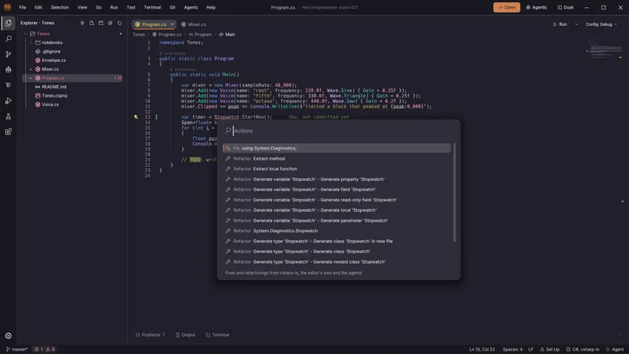](site/images/actions-3200.webp) | [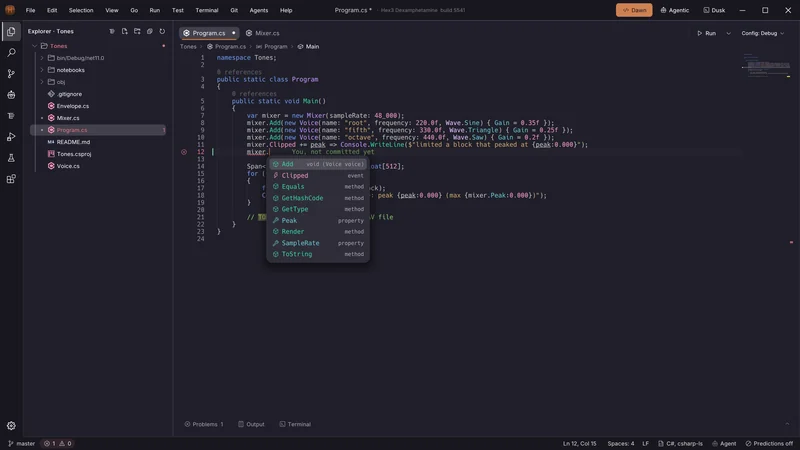](site/images/completion-3200.webp) | [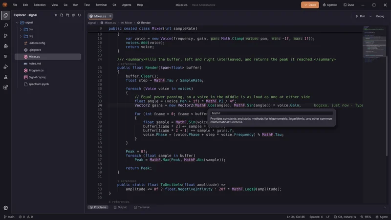](site/images/hover-3200.webp) |
| **Ctrl+.** Every fix and refactoring for the line, the best one first. | **Completion.** Straight from the language server as you type, coloured by kind. | **Hover.** Documentation under the pointer. |
| [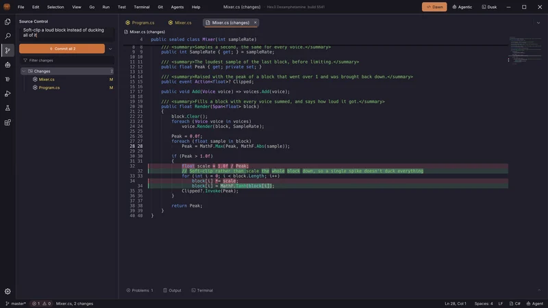](site/images/git-3200.webp) | [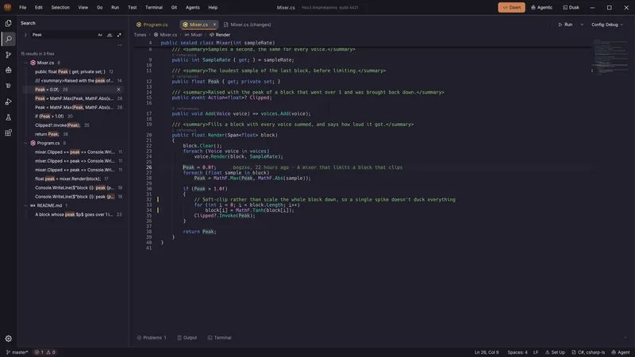](site/images/search-3200.webp) | [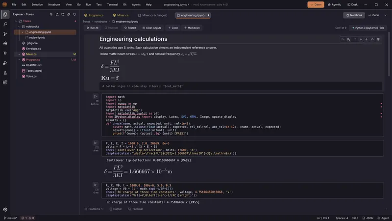](site/images/notebook-3200.webp) |
| **Git.** Word-level diffs next to the commit box. | **Search.** The whole workspace, grouped by file. | **Notebooks.** Real kernels and typeset maths, with every cell timed. |
| [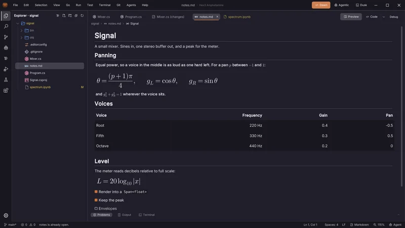](site/images/markdown-3200.webp) | [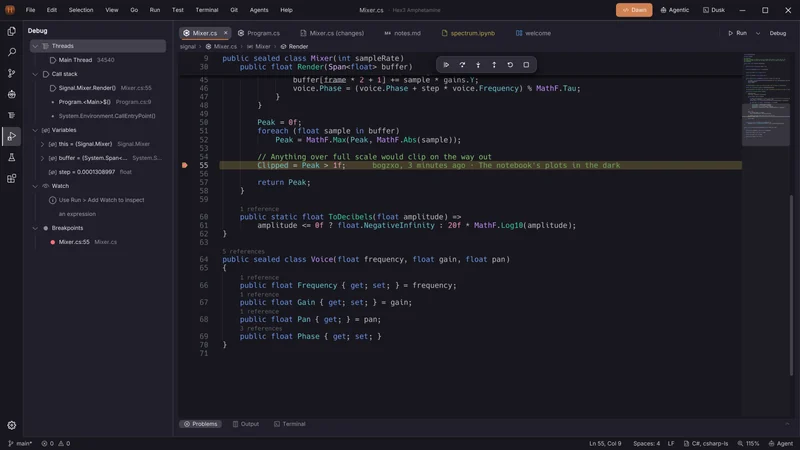](site/images/debug-1600.webp) | [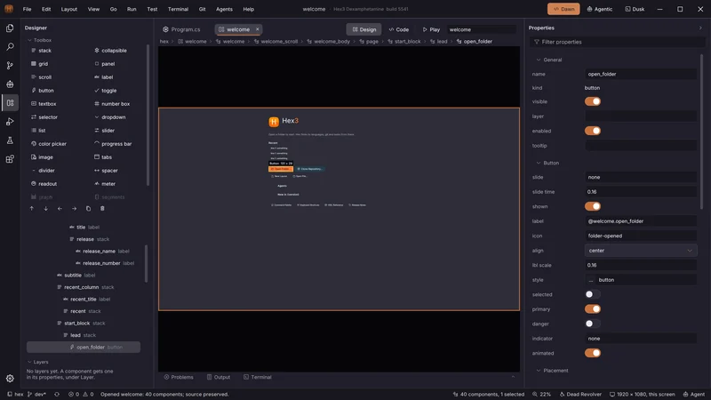](site/images/designer-1600.webp) |
| **Markdown.** Tables and maths, rendered natively. | **Debugging.** Breakpoints, stack and locals beside the code. | **Designer.** Hex's own welcome page, edited in Hex. |

## Dusk. A whole terminal.

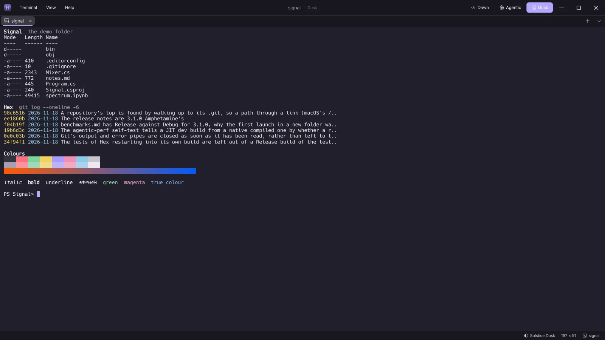

Tabs, split panes, shell profiles, search, scrollback and a drop-down mode. Run it on its own with `Hex --dusk`, use
the terminal panel inside Dawn, or switch faces from the title bar with **Ctrl+Alt+Shift+D**. Dusk says when a shell
ended and with what, a shell that failed keeps its pane so you can read why, and its tab says so. You can also make
Dusk your default terminal where the platform supports it; [the setup details are here](docs/hacking.md#building).

## Bring your own agent. Or don't.

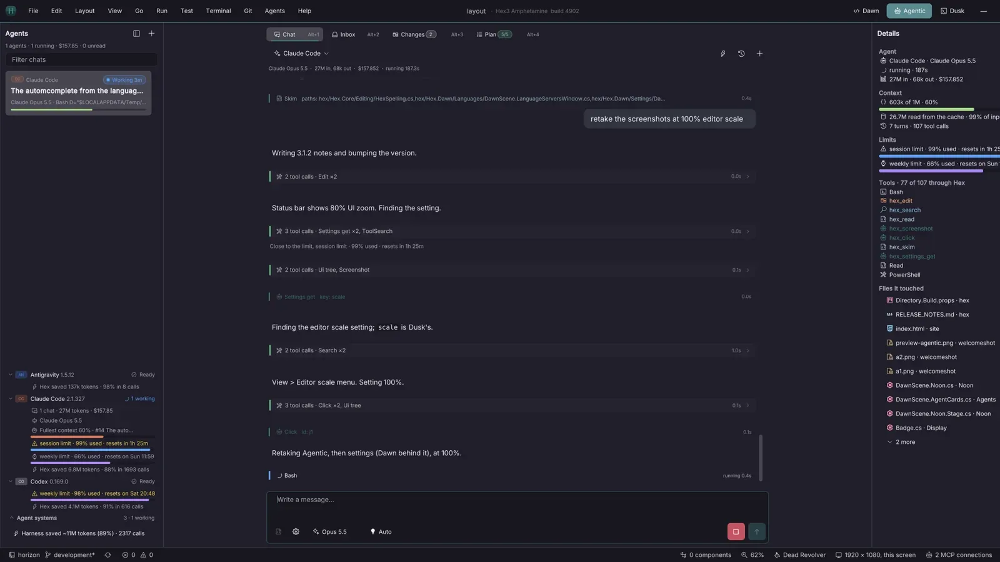

Hex doesn't sell you an AI subscription. **Agentic** runs your installed Claude Code, Codex or Antigravity CLI, with
your own account, a fleet of chats side by side, each card saying its model, tokens, cost and how full its context is.
Your provider's usage charges still belong to your provider.

- **The fleet.** Every chat is a card, and the ones waiting on you stay on top.
- **Agents that start agents.** One chat can start others, of any system and model, and they sit under it a step in.
- **The Inbox.** Every pending agent request in one place, **Ctrl+Alt+Y** allows, **Ctrl+Alt+N** denies.
- **Every change reversible.** Each turn checkpointed, keep or undo a hunk, or restore the turn.
- **80 tools over MCP.** Repository maps, symbol search, references, focused code reads, screenshots, editor commands,
  the debugger, notebooks and terminals, for any MCP client, not only the agents Hex runs. The server is off until you
  switch it on. [Agents, MCP and No AI](docs/agents.md).

**No AI**, in Settings or `Hex --no-ai`, takes the agents out at the root instead of hiding them: Agentic, the agent
extensions, their commands and their MCP tools are never loaded, and the first frame comes about 310 ms sooner.

## Coming from another editor

- **Your keys already work.** The shortcuts you learnt in that other editor, out of the box. Visual Studio's are one
  switch away.
- **Your settings come with you.** Point Hex at your old editor's `settings.json`, yours and a folder's. Every change
  is previewed first, and whatever Hex can't take is listed, not silently dropped.
- **What doesn't come over.** The other editor's extensions don't run in Hex. Its own are small HIDL scripts with a
  catalogue inside the editor. If your workflow lives in one marketplace extension, check the catalogue first, or
  [request it](https://github.com/bogzxo/hex-extensions/issues/new?template=extension_request.yml&labels=enhancement).

## Make it look how you want

| Solstice Day | Graphite |
| --- | --- |
| [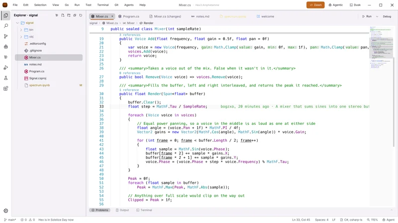](site/images/light-3200.webp) | [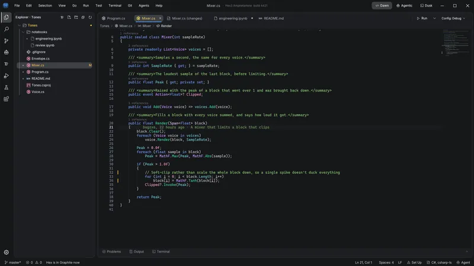](site/images/graphite-3200.webp) |
| **Fluid Glass** | **Visual Studio** |
| [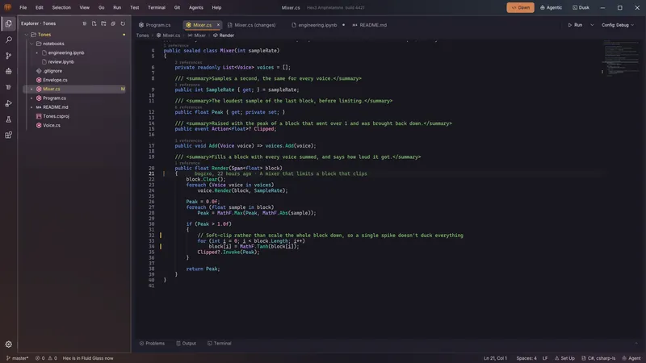](site/images/glass-3200.webp) | [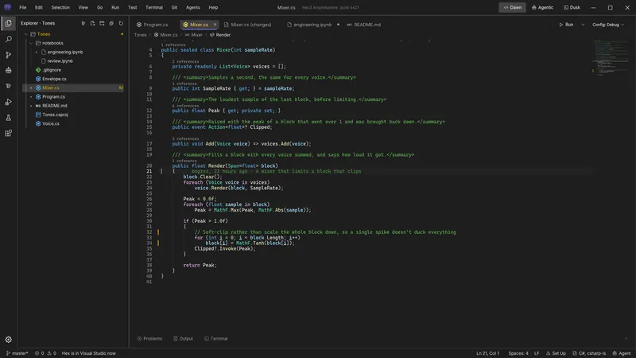](site/images/visual-studio-3200.webp) |

Hex comes in Solstice: flush panes and an accent for each face, orange for Dawn, violet for Dusk, teal for Agentic.
Go light with Solstice Day, back to quiet Graphite, float the panels in glass, or make it feel like Visual Studio. In
every look, links, dim text and accent text meet 4.5:1 contrast. Keep it calm, make it loud, or switch the effects
off, UI animation at 0 means nothing moves. It's your screen.

## What it doesn't do

**It doesn't track you.** No built-in telemetry, analytics account or crash-report upload. No sign-in to edit code.
It does make network requests for features that need them: update checks, changelogs, extension, debugger and
language-server downloads, and the services you choose to use. “No telemetry” isn't a claim that `git fetch` works by
magic.

**It doesn't require an installer.** The portable archive works too. Hex uses a writable `settings` folder beside the
executable when available, with the platform's application-data folder as a fallback.
[Platform details](docs/hacking.md#building).

## Build it

Use the SDK in [`global.json`](global.json), currently a .NET 11 release candidate. A standalone checkout needs
Horizon's `development` branch as well as Hex's extensions; this matches the engine checkout in CI.

```sh
git clone --branch development --recursive https://github.com/bogzxo/hex.git
cd hex
git clone --branch development --recursive https://github.com/bogzxo/horizon.git horizon
dotnet build Hex/Hex.csproj
```

For the **Windows x64 native build measured above**:

```sh
dotnet publish Hex/Hex.csproj -c Release -r win-x64
```

NativeAOT publishing also needs the native toolchain: Visual Studio C++ build tools and the Windows SDK on Windows,
Clang and zlib development files on Linux, or Xcode command-line tools on macOS.
[Hacking on Hex](docs/hacking.md) covers the source and self-tests, [Benchmarking](docs/benchmarks.md) the
measurements. There's an [Android tablet build](docs/android.md) of Dawn too.

Found a bug? [Open an issue](https://github.com/bogzxo/hex/issues) with your OS, Hex version and steps to reproduce it.
Want to fix it? Send a focused pull request and say how you tested it. Screenshots help when the thing you changed is
the thing people look at.
