# Modern Motherfucking Code Editor

**This is an IDE. It opens FAST, you write FAST code, and it gets the fuck out of your way, FAST.**

That's the entire fucking point. A native code editor, a proper terminal, a place for your agents, and the tools
around them. No Electron. No Chromium in a trench coat. No account to open a text file.

**[Website](https://bogzxo.github.io/hex/) · [Download](#get-it) · [The numbers](#fast-as-fuck-with-receipts) · [Gallery](#look-at-the-bloody-thing) · [Features](#lightweight-doesnt-mean-does-fuck-all) · [Build](#build-the-bloody-thing)**

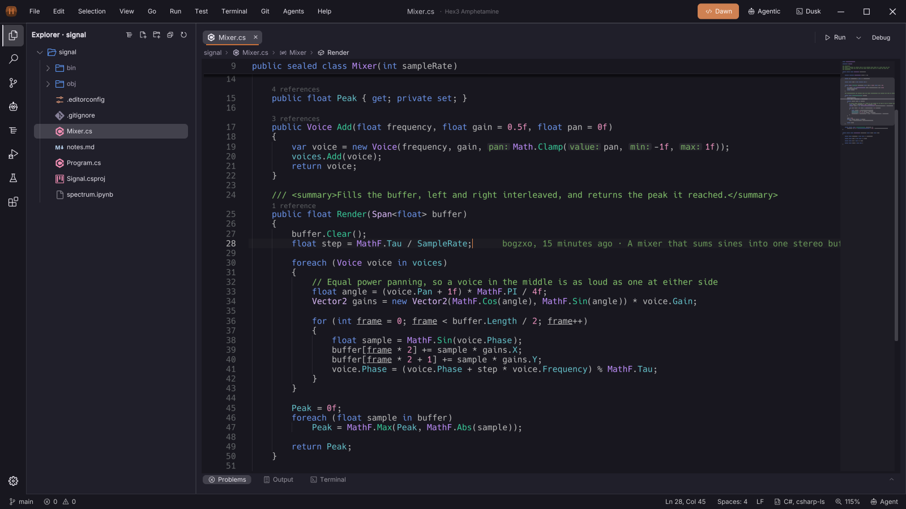

*Dawn, the editor, in Solstice. The colours, the `pan:` and `value:` hints, the reference counts and the blame at the
end of the line are csharp-ls and git talking, not a mockup. Captured from the 3.1.0 build measured below; code at 115%.*

## Get it

Pick your machine. **Setup** handles installation, shortcuts and updates. **Portable** is a ZIP you unpack and run.
Neither needs a separate .NET installation.

| System | Setup | Portable |
| --- | --- | --- |
| Windows | [x64](https://github.com/bogzxo/hex/releases/latest/download/Hex-Setup-win-x64.exe) · [ARM64](https://github.com/bogzxo/hex/releases/latest/download/Hex-Setup-win-arm64.exe) | [x64](https://github.com/bogzxo/hex/releases/latest/download/Hex-win-x64.zip) · [ARM64](https://github.com/bogzxo/hex/releases/latest/download/Hex-win-arm64.zip) |
| Linux | [x64](https://github.com/bogzxo/hex/releases/latest/download/Hex-Setup-linux-x64.zip) · [ARM64](https://github.com/bogzxo/hex/releases/latest/download/Hex-Setup-linux-arm64.zip) | [x64](https://github.com/bogzxo/hex/releases/latest/download/Hex-linux-x64.zip) · [ARM64](https://github.com/bogzxo/hex/releases/latest/download/Hex-linux-arm64.zip) |
| macOS | [Apple silicon](https://github.com/bogzxo/hex/releases/latest/download/Hex-Setup-osx-arm64.zip) · [Intel](https://github.com/bogzxo/hex/releases/latest/download/Hex-Setup-osx-x64.zip) | [Apple silicon](https://github.com/bogzxo/hex/releases/latest/download/Hex-osx-arm64.zip) · [Intel](https://github.com/bogzxo/hex/releases/latest/download/Hex-osx-x64.zip) |

Windows Setup is an EXE; unpack the Linux and macOS Setup ZIPs first. Setup can also install **Hex Dev**, the nightly
build of the development branch, beside the stable one.
[All releases](https://github.com/bogzxo/hex/releases) · [What changed](RELEASE_NOTES.md) · [Installation details](docs/installer.md)

Windows needs **10 1809 or newer**. Linux needs a Vulkan loader and driver; on Debian/Ubuntu that's
`libvulkan1` and the appropriate GPU driver, such as `mesa-vulkan-drivers`. macOS needs **11 or newer**.
The macOS build is unsigned; after downloading from this repository, remove quarantine from the unpacked folder with
`xattr -dr com.apple.quarantine /path/to/Hex` if macOS blocks it.

## Fast as fuck, with receipts

**516 ms to Dusk's first frame. 852 ms to Dawn's, with its window on screen at 456. A 49.3 MiB ZIP for the lot.**

Fresh measurements of **Hex 3.1.0 Amphetamine** at `98c6516`, published with the checked-in
[`FolderProfile`](Hex/Properties/PublishProfiles/FolderProfile.pubxml): Release, Windows x64, NativeAOT, self-contained.
Measured on 18 November 2026, Windows 11, Ryzen 5 5600X, RTX 3060, 32 GB RAM.

| Measurement | Dawn — editor | Dusk — terminal |
| --- | ---: | ---: |
| Process start → first rendered scene, median | **852 ms** | **516 ms** |
| First-frame range, 10 launches each | 821–1010 ms | 484–534 ms |
| Process start → window shown, median | 456 ms | 389 ms |
| Idle working set, median | **201.4 MiB** | **117.2 MiB** |
| Idle CPU, median, as a percentage of one logical core | 2.96% | 0.76% |

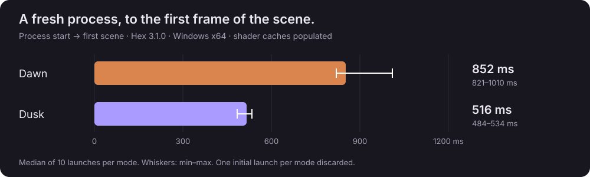

**The first launch of each mode is excluded.** It populates shader caches. These are subsequent launches,
with Dawn opening this repository and a C# source file, and Dusk opening one shell. First frame means first frame;
it doesn't mean every language server has finished indexing. Memory and CPU cover Hex itself, not child shells or
language servers. This is one machine, and a busy one: another Hex, its language servers and the agent that ran the
script were all up. It's not a race rigged against somebody else's editor.

**Dawn got slower and we're saying so.** The 2.8.0 build measured 492 ms and 149.8 MiB on 4 November. 3.1 sets up a
whole agent workspace before its first frame and it shows. The window is on screen in under half a second either way.

The published folder is **111.5 MiB**, zipped to **49.3 MiB** before runtime caches. It includes all three faces and
their assets. Release downloads may differ. [Method, raw samples and reproduction commands](docs/benchmarks.md).

### A game engine underneath. Seriously.

Hex is C# compiled ahead of time to native code. No JIT warming up while you stare at a splash screen.
The [Horizon engine](https://github.com/bogzxo/horizon) draws the interface through **Vulkan**, with rendering on its
own thread. On macOS, MoltenVK bridges that to Metal.

Text, panels, scrolling, animation and optional glass effects go through the rendering engine. There's no DOM to
lay out, no browser to haul around, and no reason a text editor should need either.

## Look at the bloody thing

Every picture is the real window, 1600 × 900, straight off the build measured above. Click one for the full size.
[How they were taken](images/readme/README.md).

| | | |
| --- | --- | --- |
| [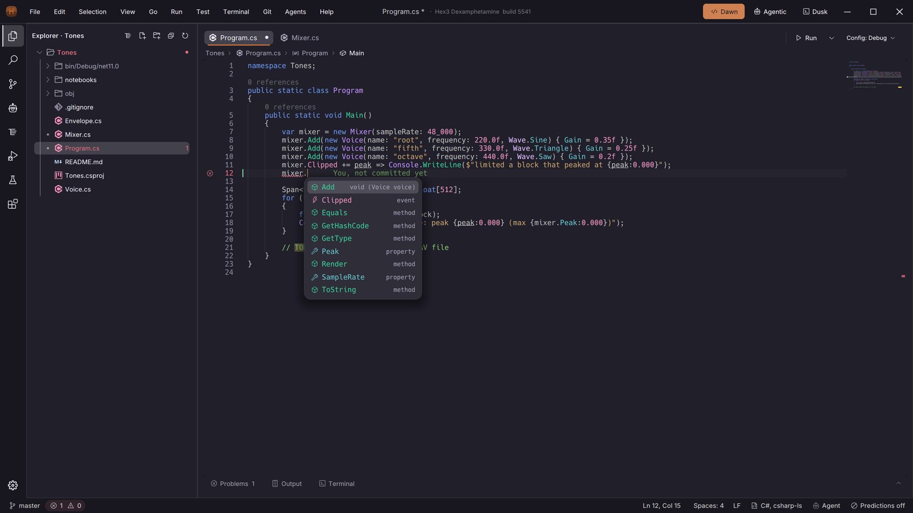](images/readme/completion.png) | [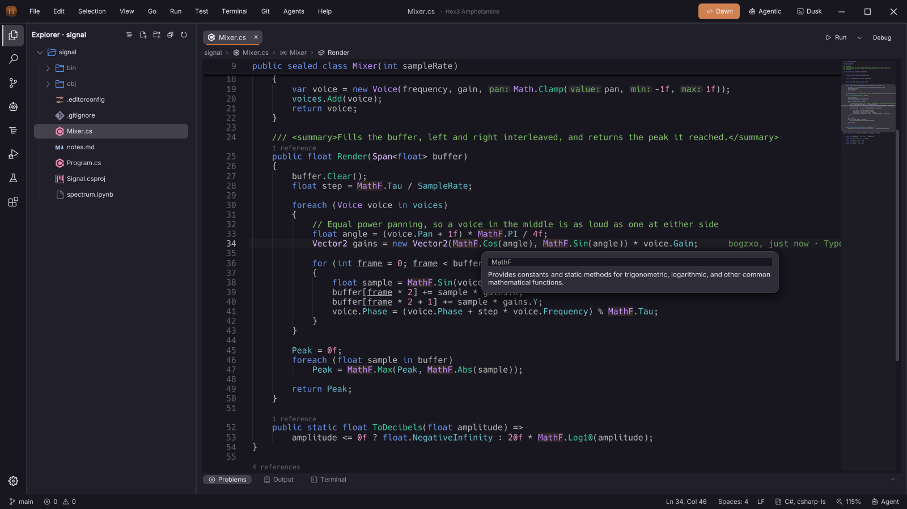](images/readme/hover.png) | [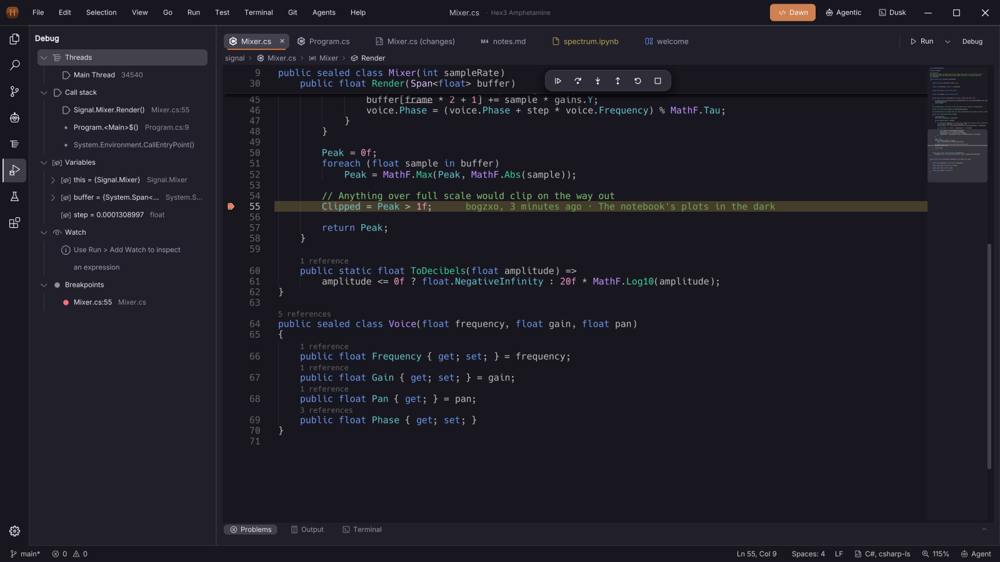](images/readme/debug.png) |
| **Completion.** The language server's, as you type. | **Hover.** Documentation where the pointer is. | **Debugging.** Stopped in `Render`, stack and locals beside it. |
| [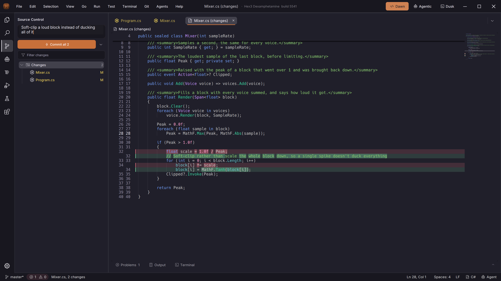](images/readme/git.png) | [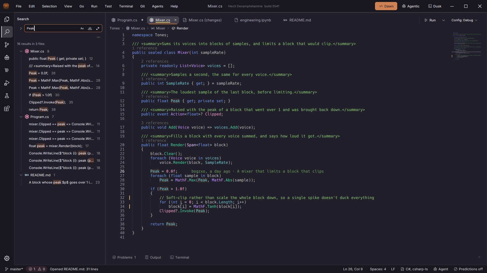](images/readme/search.png) | [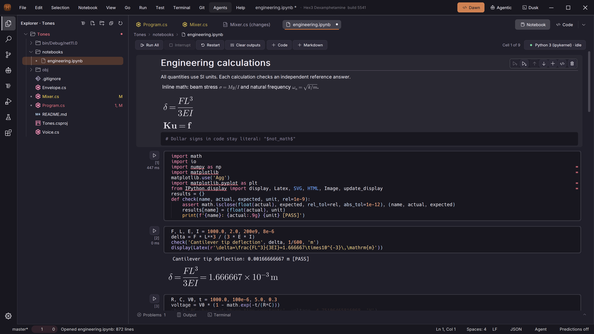](images/readme/notebook.png) |
| **Git.** What changed, word by word, next to the commit box. | **Search.** The whole workspace, grouped by file. | **Notebooks.** A real Python kernel, real plots. |
| [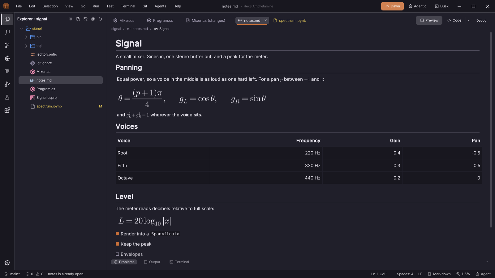](images/readme/markdown.png) | [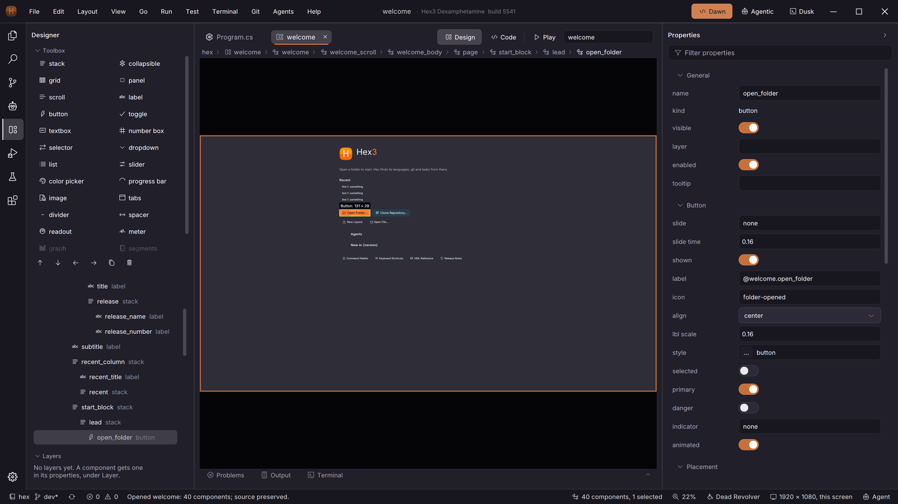](images/readme/designer.png) | [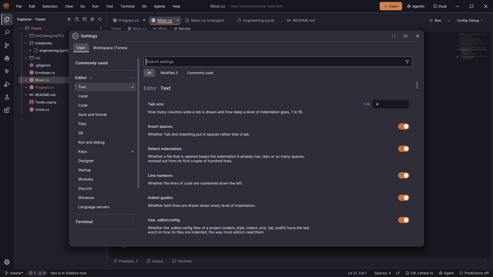](images/readme/settings.png) |
| **Markdown.** Tables and maths, drawn natively. | **Designer.** Hex's own welcome page, open in Hex. | **Settings.** Searchable, with the looks up top. |

## Lightweight doesn't mean “does fuck all”

- **Code.** Language-server completion, hovers, definitions, references, rename, quick fixes, inlay hints, reference
  counts and semantic highlighting. Folding, sticky scroll, minimap, peek, format on save and `.editorconfig`.
  Sixteen language servers come declared, C# to Rust; install the supported ones from inside Hex. Their own runtimes
  and dependencies still apply.
- **Git.** Gutter changes, stage and revert, inline blame, commits, branches, stash, history, diffs and merge-conflict
  controls. Keep the context next to the code instead of juggling windows to find out what you changed.
- **Find your shit.** Quick Open, a command palette of 360 commands, workspace search and replace, searchable settings
  and configurable keybindings with conflict reporting. Import VS Code settings instead of rebuilding your preferences
  by hand.
- **Run, debug and test.** Workspace tasks, a Test Explorer and a debugger with breakpoints, conditions, stepping,
  watches and the Debug view. .NET goes through **netcoredbg**, which Hex fetches the first time you press F5; Python
  through debugpy; D, C and C++ through lldb-dap. Project properties read and write the relevant `.csproj` settings.
- **Documents that do things.** Jupyter notebooks with real kernels and outputs; native Markdown previews with tables
  and maths. Kernels are separate tools, not secretly bundled into the download number.
- **Build interfaces.** A live layout designer for Horizon and HIDL, component properties, and evaluated HIDL values
  beside the source. [Layouts and HIDL](docs/layouts-and-hidl.md).
- **Extend it.** Extensions are small HIDL scripts with a catalogue inside Hex. Emmet, snippets and the agent systems
  are extensions like any other.

## Dusk. A whole fucking terminal.

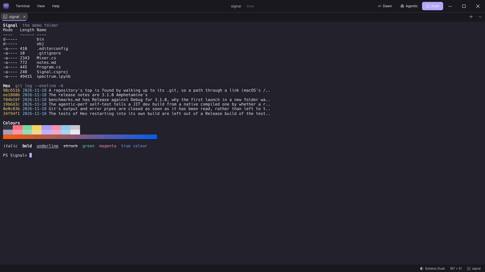

*Dusk, the terminal face, in its violet. PowerShell running a small showcase script: actual files, actual Git history, ANSI colors.*

Tabs, split panes, shell profiles, search, scrollback and a drop-down mode. ConPTY on Windows, a PTY on Linux and
macOS. Run it on its own with `Hex --dusk`, use the terminal panel inside Dawn, or switch faces from the title bar.
The editor stays where you left it.

**Ctrl+Alt+Shift+D** switches Dawn and Dusk. The shortcut is configurable.
You can also make Dusk your default terminal where the platform supports it; [the setup details are here](docs/hacking.md#building).

## Bring your own agent. Or don't.

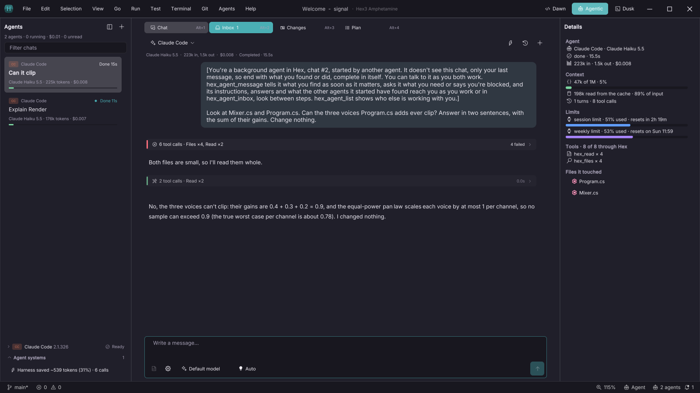

*Agentic, the agents' face, in its teal. Five small Claude Code chats at work on the demo project. This one was asked
to add envelopes to the mixer, asked leave to build, ticked off its list and said what it left undecided.*

Hex doesn't sell you an AI subscription. **Agentic** is a face of its own beside Dawn and Dusk that runs your
installed Claude Code, Codex or Antigravity CLI, with your own account. Your provider's usage charges still belong to
your provider. What's in it:

- **The fleet.** Every chat on the left as a card: its agent system, model, tokens, cost, what it's doing right now
  and a thin bar of how full its context is. A filter over them, and a panel under them of each system's version,
  session totals and what the harness saved it.
- **Agents that start agents.** One chat can start others, of any system and model, and they sit under it a step in.
  *Check the maths* above was started by *Review the mixer*, which waited for it and reported for both.
- **The chat.** Tool calls folded into quiet groups you can open, requests with what was answered, the agent's
  to-do list ticked off as it goes. A box with `@` for files and declarations, `/` for the system's commands, pasted
  pictures, and pickers for the model and how hard it thinks.
- **Details.** On the right, the chat's turns, tokens in and out, cost, how much came from the cache, your plan's
  limits, which tools it used and how many went through Hex, and the files it touched.
- **Four tabs.** Chat, Inbox, Changes and Plan, on **Alt+1** to **Alt+4**. Plan is the agent's to-do list by itself.

| | |
| --- | --- |
| [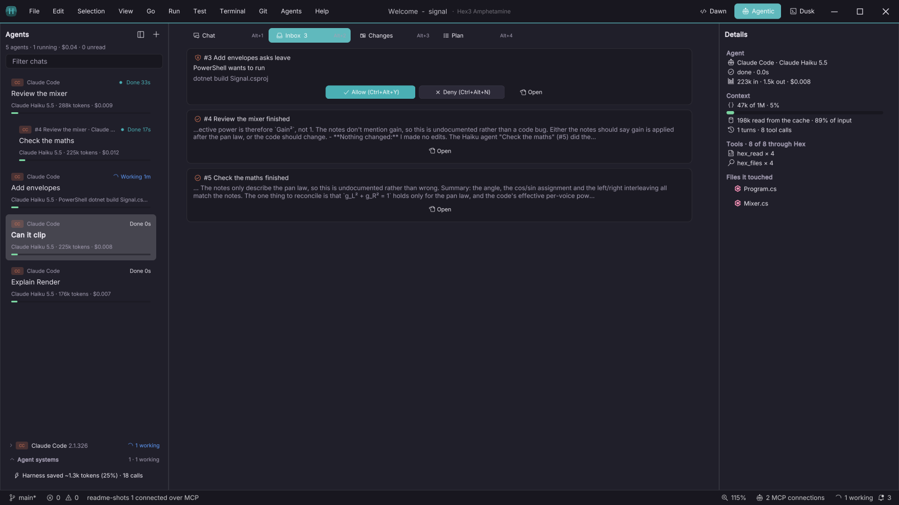](images/readme/agentic-inbox.png) | [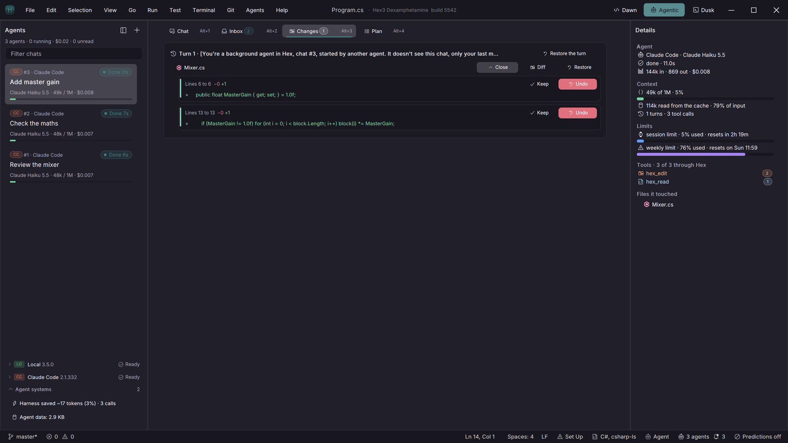](images/readme/agentic-review.png) |
| **The Inbox.** Everything any agent is waiting on you for in one place: leave to run something, a question, a chat that finished while you were elsewhere. **Ctrl+Alt+Y** allows, **Ctrl+Alt+N** denies. | **Changes you can take back.** Every turn is checkpointed as it begins. Diff it, review it hunk by hunk keeping or undoing each, or restore the whole turn. |

Agents can also connect over MCP. Hex exposes **71 tools**: repository maps, symbol search, references, focused code
reads, screenshots, editor commands, the debugger, notebooks and terminals, so an agent can ask for one method instead
of swallowing the whole bloody file. Writing this README took 54 harness calls that handed back 154,000 characters
where grep and whole-file reads would have read 1,077,000. That's 86% that never went near a context window. Every
screenshot on this page was taken by an agent driving Hex through that server. The server is off until enabled;
sending from Agentic enables it. [Agents and MCP](docs/agents.md).

## Make it look how you want

| Solstice Day | Graphite |
| --- | --- |
| [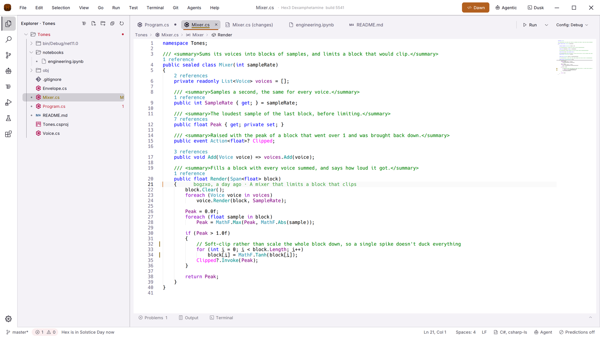](images/readme/light.png) | [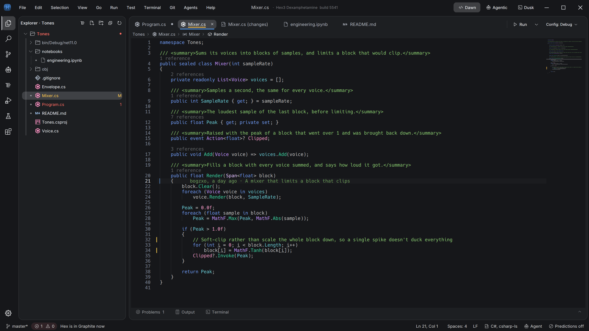](images/readme/graphite.png) |
| **Fluid Glass** | **Sunset** |
| [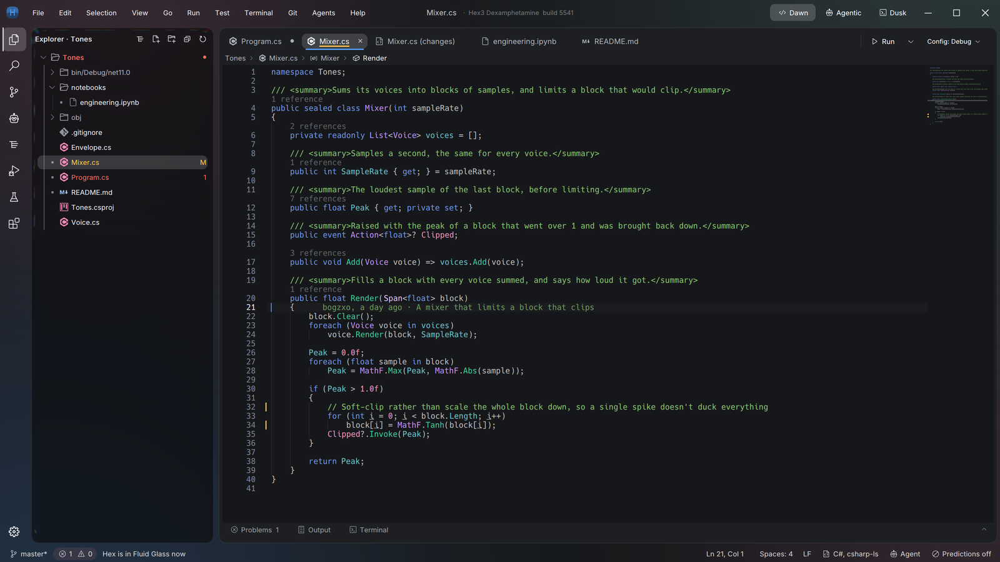](images/readme/glass.png) | [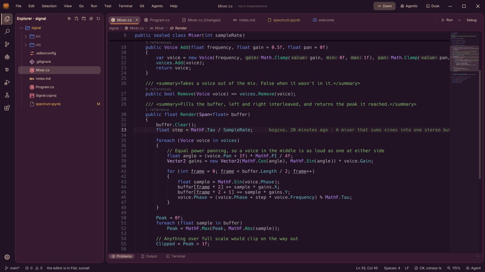](images/readme/sunset.png) |

*Same code, different mood. Click any of them for the full-size capture.*

Hex3 comes in Solstice: flush panes and an accent for each face, orange for Dawn, violet for Dusk, teal for Agentic.
Go light with Solstice Day, back to quiet Graphite, or float the panels in glass. **Settings → Appearance** has themes,
skins, saved looks, glass, backdrops and motion controls. Change the code size, terminal font, panel widths and
keybindings too. Keep it calm, make it loud, or switch the effects off. It's your screen, for fuck's sake.

## What it doesn't do

**It doesn't track you.** No built-in telemetry, analytics account or crash-report upload. No sign-in to edit code.

It does make network requests for features that need them: update checks, changelogs, extension, debugger and
language-server downloads, and the services you choose to use. Automatic extension and language-server update checks
have switches. Git remotes, language servers, extensions, notebook kernels and agent CLIs have their own network
behavior. “No telemetry” isn't a claim that `git fetch` works by fucking magic.

**It doesn't require an installer.** The portable archive works too. Hex uses a writable `settings` folder beside
the executable when available, with the platform's application-data folder as a fallback. [Platform details](docs/hacking.md#building).

## Build the bloody thing

Use the SDK in [`global.json`](global.json), currently a .NET 11 release candidate. A standalone checkout needs Horizon's
`development` branch as well as Hex's extensions; this matches the engine checkout in CI.

```sh
git clone --branch development --recursive https://github.com/bogzxo/hex.git
cd hex
git clone --branch development --recursive https://github.com/bogzxo/horizon.git horizon
dotnet build Hex/Hex.csproj
```

For the **Windows x64 native build used above**:

```sh
dotnet publish Hex/Hex.csproj -p:PublishProfile=FolderProfile
```

NativeAOT publishing also needs the native toolchain: Visual Studio C++ build tools and the Windows SDK on Windows,
Clang and zlib development files on Linux, or Xcode command-line tools on macOS.
[Hacking on Hex](docs/hacking.md) covers the source and self-tests. [Benchmarking](docs/benchmarks.md) covers the measurements.
There's an [Android tablet build](docs/android.md) of Dawn too.

Found a bug? [Open an issue](https://github.com/bogzxo/hex/issues) with your OS, Hex version and steps to reproduce it.
Want to fix it? Send a focused pull request and say how you tested it. Screenshots help when the thing you changed is
the thing people look at.
