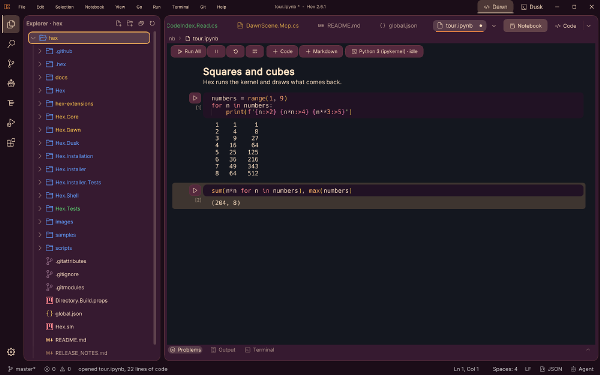
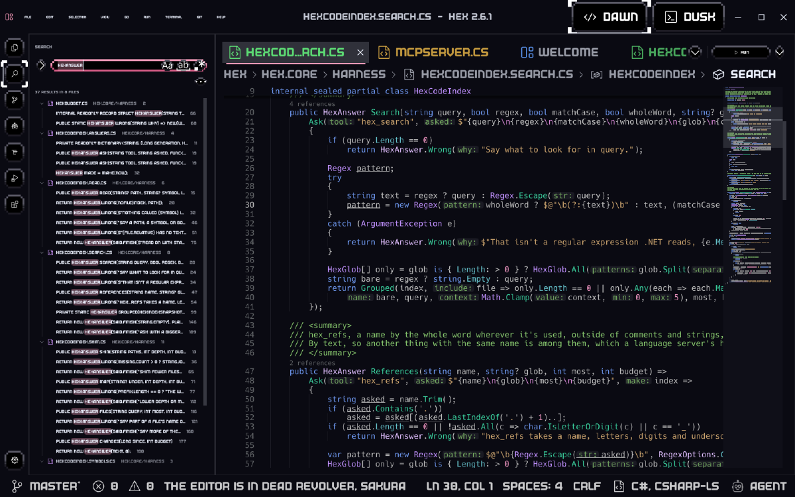
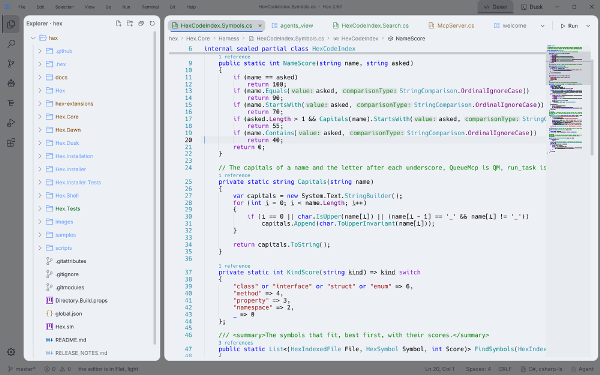
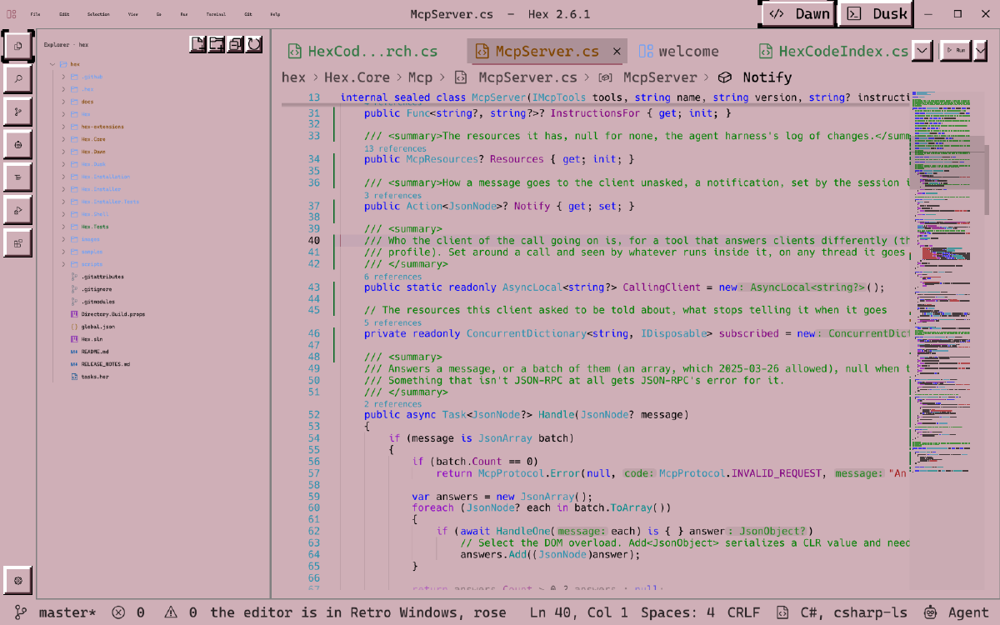
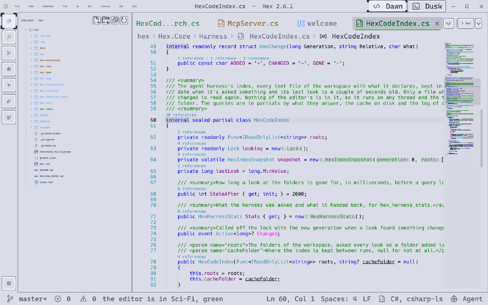

# Modern Motherfucking Code Editor

**This is an IDE. It opens, you write code, and it gets the fuck out of your way.**

That's entire _fucking_ **POINT**.
We've been using editors that ship a full chromium browser, a JS runtime, an account system, a
telemetry pipeline and an upsell, and somewhere in the middle of all that, there's a text box...

Hex is the text box, and then everything a working developer actually needs round it, and nothing else.

No Electron. No Chromium wearing a code editor cloak. No accounts, no sign in to sync, no telemetry, no AI that you
didn't ask for, no "try our new assistant _we promise we won't spy_", no marketplace of first party "experiences" waving at you from
the activity bar. It's a native program that draws its own UI on your GPU and does what you fucking tell it to.

## Fast as fuck, _boy_
Measured on Hex 2.0.0, the release build, on a Ryzen 5 5600X with an RTX 3060, opening this repository.

- process start to `main` **14 ms**
- window on screen **~0.4 s**
- editor up, repository open, first real frame **0.5 s** (461 to 594 ms, 515 ms median)
- the very first launch, filling the shader cache **2.9 s**, once, ever
- memory, sat there idle **~128 MB** working set, 20 MB managed heap
- CPU, sat there idle **~0.5%** of one core
- garbage made per idle tick **0 bytes**
- download -> **~35 MB** zip, nothing to install, .NET is packaged

Half a second from double click to typing. Go time your current editor, I'll wait.... Actually I won't, I've already
opened the file.

It gets there by not doing stupid shit. It's C#, compiled ahead of time to a teeny tiny native binary, so there's no runtime to
spin up and no JIT warming up while you watch. It draws with Vulkan through the ultra fast Horizon game engine, on a
render thread of its own. When nothing's happening it does nothing, and when you're typing, a tick costs a few
milliseconds. Every number here comes out of Hex itself, `HORIZON_LOG_STARTUP=memory` gets you the same on your system.

## Fully featured, not "lightweight"
"Lightweight" usually means "does fuck all". Hex is light and it does the job.

- **Code.** Any language with a language server, 15 known out of the box and installed with a click (C#, C and C++, Rust,
  Go, Python, TypeScript, D, Bash, YAML, TOML, JSON, Markdown and the rest). Completion, hovers, go to definition,
  peek, find references, inlay hints, a minimap, format on save, editorconfig. Semantic highlighting that colours a name
  by what it actually is, in ReSharper's colours for C#. TODO and FIXME lit up in everything.
- **Git, inside.** Changes in the gutter with stage and revert on a click, blame on the line you're on, staging, commits,
  amend, branches, merge, rebase, cherry-pick, stash, tags, word level diffs, merge conflicts you settle with a button,
  file history and a local history of every save.
- **A real terminal.** Dusk, both built in, and standalone, ConPTY on Windows and a pty everywhere else, tabs, splits and a
  drop down. It can be your system's default terminal if you want it to be.
- **Debugging.** Currently it's just breakpoints, stepping and the Debug side for .NET, through netcoredbg, thanks uncle sammy.
- **For .NET people.** A properties panel that reads Build Action and Copy to Output Directory from the SDK itself and
  writes them back into the .csproj without wrecking it, tasks for any solution, and Hex builds and restarts itself.
- **The usual furniture.** Command palette, quick open, search and replace across files, a settings window that
  actually finds things, workspace settings, a key bindings table with conflicts and chords, and an importer for your
  VS Code settings so you can leave without rebuilding your config by hand.
- **A layout designer and a language.** Hex is the editor of the [Horizon](https://github.com/bogzxo/horizon) engine and
  of HIDL, its language. A layout opens as a designer with a live canvas, and HIDL files show what they evaluate to as
  you type.
- **Everywhere.** Windows, Linux (Wayland or X11) and macOS, all the same program.

## What it doesn't do

**It doesn't FUCKING track you.** No telemetry, no analytics, no crash reports phoning home, no account, no identifiers. Here is
every single time Hex goes online, to GitHub unless it says otherwise.

- Once a day, new versions of the language servers you've got. Off with one switch in the settings.
- Once a day, new versions of extensions you installed yourself out of the catalog. Off with another one.
- The changelog, when you open it.
- Hex updates, when you choose **Help → Check for Updates**. Setup downloads the release only after you choose Install.
- An extension, a language server or a debug adapter, when you click install (a server comes through its own
  installer, npm or dotnet or whatever it says).

That's it. Switch both off and Hex never says a word to anybody unless you ask it to.

**It doesn't push shit at you.** There's no "recommended extensions" nagging, no first party plugins installed behind your
back, no service to sign up for, no "Hex Pro" or "Hex AI+". The extensions catalog is there if you go looking, and that's where it
stays. Extensions are HIDL [(Horizon Integrated Development Language)](https://github.com/bogzxo/hidl) you can read in a text editor,
which is handy, because you're holding one around the tips of your fingers :)

**It doesn't need installing.** Unzip it anywhere and run it. Settings live in a folder next to it, so carry it around
on a fucking stick if you want.

## Bring your own agent

Hex doesn't ship an AI and it isn't selling you one. What it does is give the agent *you* chose (Claude Code, Codex,
whatever's next) the best seat in the house, and then get out of the way like everything else here.

**It runs them.** The robot on the activity bar is the Agents view. Pick an agent, ask it something, and watch it work.
Every tool it calls gets a row of its own with an icon for what it is and a spinner while it's going, what it said comes
out as proper Markdown, and a `path:line` in an answer opens the file right there. The file you're looking at goes in
with the question if you want it to, there's a model picker, a permissions or sandbox picker, Up for what you asked
last, Escape to stop it, and the tokens and the cost of the turn sit quietly at the top. Hex runs the agent's own
program (`claude -p`, `codex exec`) with your own account, it doesn't proxy anything anywhere.

**It hands them the codebase without the bill.** Agents spend most of their tokens *finding* things. Grep, a wall of
absolute paths, a two thousand line file read whole to look at one method, grep again. Hex already knows your
workspace, so it gives agents a harness over its MCP server that answers the way they actually want it.

- `hex_map` the repository as a tree with the languages and types in each folder
- `hex_symbols` where something is declared, ranked, `QM` finds `QueueMcp`
- `hex_search` ranked and grouped by file, declarations first, the path written once and not on every line
- `hex_refs` where a name is used, without the comments and the strings
- `hex_read` **one method out of a file by its name**, instead of the whole bloody file
- `hex_skim` what a bunch of files are, their summaries and outlines, in one call
- `hex_changes` what moved since the agent last looked, or subscribe and get told

On Hex's own repository a handful of real questions took **10 calls and 72,224 characters** the grep and read way, and
**7 calls and 18,275** through the harness. That's 75% of the tokens gone, every time, for nothing. The index is kept
between runs, takes the symbols of your language servers where it can, and answers in a few milliseconds.
[docs/agent-harness-validation.md](docs/agent-harness-validation.md) has every number.

**And it lets them drive.** Screenshots, the UI tree, clicks, typing, commands, problems, definitions, the terminal with
a command run and *waited for* down to its exit code, notebooks by their path, tasks, settings, plus line edits you
asked for and dismissible code hints.

The agents plug in as extensions, Claude Code and Codex are in the catalog (Extensions, Available), and anything that
speaks MCP over stdio connects the same way.

```
claude mcp add hex -- C:\path\to\Hex.exe --mcp
```

The server is off until you switch it on (or press Send in the Agents view, which is you switching it on). When it's on
it listens on a pipe only you can open, only from your machine, only with a token Hex writes next to itself, and a
repository you cloned can't switch it on for you. While an agent's connected the status bar says so.
[docs/agents.md](docs/agents.md) has the details and every tool.

## Looks like this


*Jupyter notebooks, the real kernel, outputs and all. Sunset.*


*Find in Files. It's a game engine's UI underneath, so it wears game skins too, this one's Dead Revolver, Sakura.*

| | |
| --- | --- |
|  |  |
| *Light* | *Retro Windows, Rose* |
|  |  |
| *Sci-Fi, Green* | *Sunset* |

Thirty odd skins and themes, all of them in **Settings, Appearance**, switched while you watch. And the busy bits
actually move now, a sync spins, a server that's starting spins, a game that's running pulses, so you can tell at a
glance whether something's working or dead.

## Get it

**Hex Setup**, the installer, for
[Windows x64](https://github.com/bogzxo/hex/releases/latest/download/Hex-Setup-win-x64.exe),
[Windows ARM64](https://github.com/bogzxo/hex/releases/latest/download/Hex-Setup-win-arm64.exe),
[Linux x64](https://github.com/bogzxo/hex/releases/latest/download/Hex-Setup-linux-x64.zip),
[Linux ARM64](https://github.com/bogzxo/hex/releases/latest/download/Hex-Setup-linux-arm64.zip),
[macOS Apple silicon](https://github.com/bogzxo/hex/releases/latest/download/Hex-Setup-osx-arm64.zip) and
[macOS Intel](https://github.com/bogzxo/hex/releases/latest/download/Hex-Setup-osx-x64.zip). Run the Windows EXE directly; unpack the Linux or macOS ZIP first.
Setup fetches the newest Hex, gives it shortcuts and a place in the app menu, an uninstaller, and updates from inside Hex
(Help, Check for Updates). [Hex Setup](docs/installer.md) has what it does on each system.

Or grab the portable zip for your system from [Releases](https://github.com/bogzxo/hex/releases), unpack it anywhere
and run `Hex`.

- **Windows** 10 1809 or later.
- **Linux** with the Vulkan loader and a driver (`libvulkan1` and `mesa-vulkan-drivers` on Debian and Ubuntu).
  `scripts/install-desktop.sh` gets its name and icon in your dock.
- **macOS** 11 or later. It isn't signed, so run `xattr -dr com.apple.quarantine Hex` on the unpacked folder first.

Or build it.

```
git clone --recursive https://github.com/bogzxo/hex
dotnet build Hex/Hex.csproj
```

## More

- [Layouts, HIDL and the workspace](docs/layouts-and-hidl.md), the designer, HIDL's values and console, and its language server
- [Agents](docs/agents.md), the MCP server and its tools, and the Agents view
- [The agent harness](docs/agent-harness-plan.md), how the index, the tools and the agents' extensions work
- [Hacking on Hex](docs/hacking.md), finding your way round the code, building on every system, the self test
