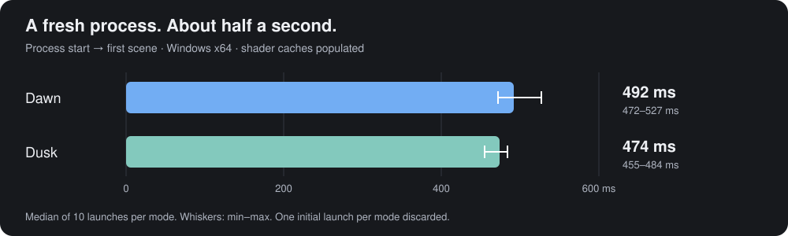

# Hex publish-build measurements — 4 November 2026

These are measurements of the local **Hex 2.8.0 “thickboy” development working tree**, including unpublished changes
to Hex and Horizon. They replace the Hex 2.0.0 figures formerly in the README. They are not measurements of the
existing `v2.8.0` download, a Debug build, or a self-test session.

## Results

Ten measured launches per mode, after **one discarded launch of Dawn and one discarded launch of Dusk** to populate
shader caches. No first-launch result is included in the statistics. “Warm” here means subsequent process launches
with caches left intact, not reopening a window in an already running process.

| Metric | Dawn median | Dawn min–max | Dusk median | Dusk min–max |
| --- | ---: | ---: | ---: | ---: |
| Process start → `main` | 11.5 ms | 11–13 ms | 11 ms | 11–13 ms |
| Process start → first rendered scene | **492 ms** | 472–527 ms | **474 ms** | 455–484 ms |
| Idle working set | **149.8 MiB** | 149.5–149.9 MiB | **114.1 MiB** | 113.9–114.3 MiB |
| Idle private bytes | 216.4 MiB | 215.4–216.8 MiB | 169.4 MiB | 167.9–170.5 MiB |
| Idle CPU, % of one logical core | 4.33% | 3.08–5.86% | 12.81% | 1.24–13.89% |



Working set is resident process memory. Private bytes is a different Windows process metric, not another working-set
measurement and not managed-heap size. Each launch's memory result is the mean of its idle samples; the table then
takes the median and range across ten launches. CPU is process CPU time divided by elapsed time: **100% means one
logical core**, not the whole 12-thread CPU. For orientation, the medians normalize to approximately 0.36% and 1.07%
of total logical-processor capacity on this machine. Dusk's idle CPU varied considerably; the full range is retained.

Both modes share one distribution:

| Published package | Bytes | MiB |
| --- | ---: | ---: |
| Entire publish folder, 232 files | 106,237,076 | 101.3 |
| ZIP of that folder | 47,144,371 | 45.0 |
| `Hex.exe` within the folder | 45,579,776 | 43.5 |

MiB means 1,048,576 bytes. The ZIP was made with .NET's `ZipFile.CreateFromDirectory`, `CompressionLevel.Optimal`,
before launching the app. It includes the published assets and native dependencies, but no generated shader cache,
downloaded language servers, notebook kernels or user data. It is a locally generated archive, not a release-asset
download-size measurement. Other RIDs and archive tools can produce different sizes.

## Machine and build

- Windows 11 Pro, build **26300**, x64.
- AMD Ryzen 5 5600X, 6 physical cores / 12 logical processors; 32 GB installed RAM.
- NVIDIA GeForce RTX 3060, Windows driver `32.0.16.2101` (621.01).
- .NET SDK **11.0.100-rc.2.26504.105**.
- [`FolderProfile.pubxml`](../Hex/Properties/PublishProfiles/FolderProfile.pubxml): Release, `net11.0`, `win-x64`,
  self-contained NativeAOT. Only the output directory was overridden.
- Hex base commit: `e825f671b52afca52da08aaf8162ba8fe9bbf5ae`; local changes included.
- Horizon base commit: `12ee3a1762e504b0e03451767a61f4b34ccf9f70`; local changes included.
- Measured executable SHA-256:
  `E66A1C0CB7CEE5C287E724515FF83CD2CF5CABDBDCB80FE00BCF03EEA4488445`.

The base commits alone do **not** reconstruct this unpublished working tree. The executable hash identifies the
measured binary; the script below reproduces the procedure on whichever source revision you publish.

## Procedure and limits

1. Publish into a new directory and archive its contents before running Hex.
2. Give the run an isolated `HEX_HOME`. Set `HORIZON_LOG_STARTUP=1` and `HEX_PROFILE=0`.
3. Launch Dawn once, wait for its first scene and five seconds of settling, then close it. Do the same for Dusk.
   Discard both runs; retain the shader cache for all following launches.
4. Measure ten new processes of each mode. Alternate the order by pair: Dawn/Dusk, then Dusk/Dawn.
5. Use the startup trace's `first frame of the scene shown at … ms` marker. Its clock starts at process start;
   it does not start when the script notices the line. Do not add the discarded warmups to the dataset.
6. After that marker, allow five seconds to settle. Sample working set and private bytes every 250 ms for five seconds.
   Measure process CPU-time growth over the same interval, then close that process before starting the next one.

Dawn ran with `--window --fresh --size 1600x900`, the local Hex repository open, and
`Hex.Dawn/Shell/DawnScene.cs` open. Dusk ran with `--dusk --size 1600x900 --cwd <Hex repository>` and its default shell.
Default display scaling and default appearance were used. Screenshot-only theme and font changes were made afterward
in separate settings folders, not during the benchmark.

These are **normal application launches**, not `--selftest` launches. First rendered scene is not a measurement of
keyboard responsiveness, language-server readiness, complete repository indexing, or a ready shell prompt. The
startup trace is enabled during measurement. The first warmup can also populate OS and application caches beyond
shaders; caches were not flushed between runs.

CPU and memory cover the **Hex process only**. Shells, language servers and other child processes are excluded.
The workload was a live development workstation, not an otherwise empty laboratory machine; network availability,
background tasks, focus, drivers, refresh rate, installed tools and repository size can affect results. No other
editor was measured. No cross-platform speed claim or statistical significance is inferred from this small sample.
Managed-heap size and allocations were not measured in this run.

## Reproduce on Windows

From the Hex repository, with the engine available and native publishing prerequisites installed:

```powershell
# Use new output folders; keep the publish output separate from the measurement output.
$publish = Join-Path $PWD 'artifacts/readme-publish'
dotnet publish Hex/Hex.csproj -p:PublishProfile=FolderProfile "-p:PublishDir=$publish/"

# Optional: measure the distribution before it creates caches.
Add-Type -AssemblyName System.IO.Compression.FileSystem
$archive = Join-Path $PWD 'artifacts/Hex-win-x64.zip'
[IO.Compression.ZipFile]::CreateFromDirectory($publish, $archive,
    [IO.Compression.CompressionLevel]::Optimal, $false)
Get-Item $archive | Select-Object Length
Get-ChildItem $publish -Recurse -File | Measure-Object Length -Sum

./scripts/measure-readme.ps1 -PublishedDirectory $publish -Repository $PWD `
    -OutputDirectory (Join-Path $PWD 'artifacts/readme-results') -Samples 10
```

The script refuses to overwrite an existing measurement directory. It creates `samples.json` with measured runs
only, `machine.json`, and per-launch stdout/stderr logs. Launch `0` is the discarded warmup for that mode. It restores
the caller's environment variables afterward. Close unrelated workloads for a quieter run; do not compare results
from different machines as though they came from the same conditions.

The recorded run used the shared workspace's Horizon checkout and wrote to
`artifacts/readme-refresh/publish` and `artifacts/readme-refresh/benchmarks` at workspace level.

## Evidence

- [All 20 measured samples](benchmarks/2026-11-04/samples.json)
- [Recorded machine metadata and binary hash](benchmarks/2026-11-04/machine.json)
- [Package byte counts](benchmarks/2026-11-04/package.json)
- [Startup markers, including separately labeled discarded warmups](benchmarks/2026-11-04/startup-markers.txt)
- [Measurement script](../scripts/measure-readme.ps1)
- [Screenshot provenance](../images/readme/README.md)
